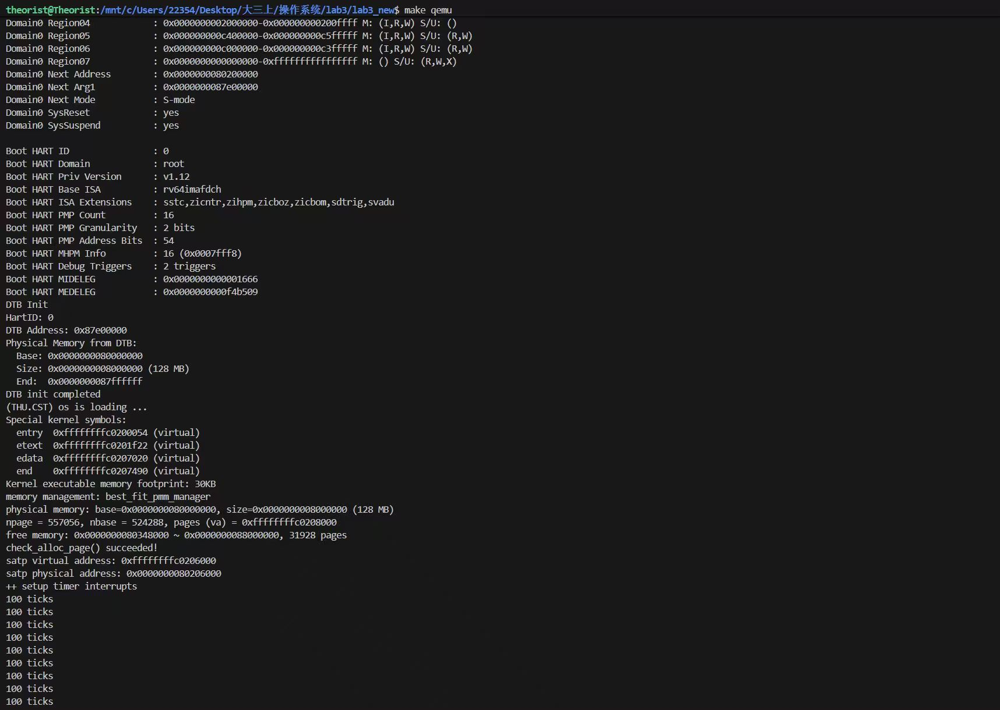
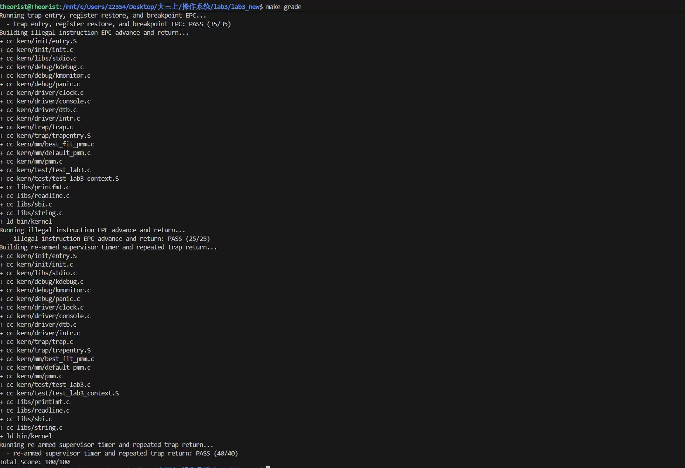

# 操作系统实验报告

## 实验基本信息

| 项目 | 内容 |
| --- | --- |
| **实验名称** | Lab3：断，都可以断——中断与异常处理 |
| **小组成员** | 2411820-刘家文、2414004-王乐、2413994-陈宇凡 |
| **完成日期** | 2026-11-05 |
| **代码分支** | [OSlab / lab3](https://github.com/liujiawen2005/OSlab/tree/lab3) |
| **代码目录** | [code/](https://github.com/liujiawen2005/OSlab/tree/lab3/code) |
| **代码核对版本** | `a0328e83e96526f84ab6c1d4d6c2ee8226ea0e38` |
| **演示评分** | 所提供截图显示 `Total Score: 100/100` |

### 小组分工

实验按两个功能模块分工。各模块负责人提供实现分析和对应验证说明，报告负责人统一整理实验流程、测试材料和总结。

| 成员 | 负责的练习 / 模块 |
| --- | --- |
| 2413994-陈宇凡 | 模块一：Trap 上下文恢复与 Trap 入口，负责 RESTORE_ALL、__alltraps |
| 2414004-王乐 | 模块二：中断与异常处理，包括时钟中断、非法指令和断点异常 |
| 2411820-刘家文 | 报告撰写与实验材料整理 |

---

## 一、实验目的

1. 理解 RISC-V 中断、异常与 Trap 的关系，掌握 `stvec`、`scause`、`sepc`、`sstatus` 等寄存器的作用。
2. 根据既有 `SAVE_ALL` 与 `struct trapframe` 的布局实现上下文恢复，建立汇编入口到 C 语言处理函数再返回原执行流的完整链路。
3. 实现中断与异常分类处理，使非法指令和断点异常能够在更新返回地址后继续执行。
4. 理解时钟事件的重新设置、中断计数和周期性输出，通过持续时钟中断验证多次 Trap 返回的正确性。
---

## 二、实验环境

### 2.1 开发与运行条件

| 项目 | 内容 |
| --- | --- |
| 目标架构 | RISC-V 64 位 |
| 模拟平台 | QEMU |
| 固件 | QEMU 默认 OpenSBI，启动参数为 `-bios default` |
| 交叉工具链 | Makefile 使用 `riscv64-unknown-elf-` 前缀工具 |
| 构建与评分 | GNU Make、Python 3 注入脚本、Shell 评分脚本 |
| 内核加载方式 | `-kernel bin/ucore.img`，内核物理入口为 `0x80200000` |


### 2.2 AI 工具使用情况

| 成员 | AI 编程工具 | 底层模型 | 备注 |
| --- | --- | --- | --- |
| 2414004-王乐 | Cursor | 豆包 |  |
| 2411820-刘家文 | codex | gpt-6 |  |
| 2413994-陈宇凡 | Cursor | Claude Opus 5.5 |  |

---

## 三、实验整体逻辑分析

### 3.1 本章节的逻辑主线

Lab1 使内核能够启动，Lab2 建立物理内存管理基础，Lab3 则使内核能够响应执行过程中的中断和异常。核心问题是：处理器被打断后，如何保存当时的执行状态，完成处理，再恢复到正确的位置继续运行。

Trap 是中断和异常进入处理流程的统一入口。中断通常由计时器或外部设备等异步事件引起；异常与当前执行的指令有关，例如非法指令和断点。两者使用相同的上下文保存与返回机制，但具体处理策略及返回地址的调整方式不同。

```text
硬件记录 Trap 原因、返回地址和状态
→ 跳到 stvec 指定的 __alltraps
→ SAVE_ALL 在内核栈上建立 trapframe
→ 将 trapframe 指针放入 a0，调用 trap(tf)
→ trap_dispatch 根据 cause 区分中断和异常
→ interrupt_handler / exception_handler 完成处理
→ __trapret 执行 RESTORE_ALL
→ sret 根据恢复的 sepc 和 sstatus 返回
```

### 3.2 功能的逐步实现

1. **承接 Lab2 与启动环境。** 补齐物理页初始化、Best-Fit 管理器，并处理内核加载和分页开启时的地址映射，使内核能够到达初始化代码。
2. **建立 Trap 入口。** `idt_init()` 将 `__alltraps` 写入 `stvec`，使用直接入口模式，使各类 Trap 进入统一汇编入口。
3. **实现入口与恢复。** 保持 `SAVE_ALL` 和 `trapframe` 布局一致，完成 `RESTORE_ALL`、参数传递及返回流程。
4. **完成异常与中断处理。** 区分 Trap 原因，处理非法指令、断点和监督态时钟中断，并维护正确的返回状态。
5. **验证持续工作。** 利用寄存器测试、异常返回测试及持续时钟测试，检查一次和多次 Trap 后程序是否仍能继续运行。

### 3.3 硬件与软件的分工

发生 Trap 时，硬件会更新 `sepc`、`scause` 和 `sstatus` 中的相关状态，并将执行位置转移到 `stvec`。硬件不会替我们把全部通用寄存器保存到内核栈，也不会自动建立 C 语言可以读取的 `trapframe`。

因此，汇编入口负责保存和恢复完整的软件上下文，C 语言处理函数负责解释原因并执行处理策略。二者必须通过同一份 Trap frame 协作，才能保证处理前后的状态一致。

---

## 四、实验内容与实现

### 4.1 代码完成


| 文件 | 原始框架与最终代码的主要区别 | 所属作用 |
| --- | --- | --- |
| `kern/trap/trapentry.S` | 补全 `RESTORE_ALL`，在 `__alltraps` 中增加参数传递与 `trap` 调用 | Lab3 核心模块一 |
| `kern/trap/trap.c` | 增加 `interrupt_handler()`、`exception_handler()` 和指令长度辅助判断 | Lab3 核心模块二 |
| `kern/mm/pmm.c` | 补全 `page_init()` 并选择 Best-Fit 管理器 | 承接 Lab2 的前置代码 |
| `kern/mm/best_fit_pmm.c` | 从空缺框架补为完整分配模块 | 承接 Lab2 的前置代码 |
| `kern/init/entry.S` | 增加低地址恒等映射，支持开启分页后的过渡取指 | 启动适配 |
| `Makefile` | 正常运行、调试等目标由通用 loader 改用 `-kernel` | 加载与固件交接适配 |


### 4.2 功能模块一：Trap 上下文恢复与汇编入口

**负责人：** 2413994-陈宇凡。

#### 模块功能与接口

主要补全 `RESTORE_ALL` 宏及 `__alltraps` 中汇编到 C 的调用关系，使用既有接口：

```c
void trap(struct trapframe *tf);
```

该模块必须把被打断状态交给 C 处理函数，并在处理结束后从同一份 Trap frame 恢复执行状态。

#### Trap frame 布局

RV64 中 `REGBYTES = 8`，`struct trapframe` 共占 36 个寄存器宽度，即 288 字节。

| 内容 | 相对当前 Trap frame 栈指针的偏移 |
| --- | --- |
| `x0`—`x31` 的保存槽 | `0*REGBYTES`—`31*REGBYTES` |
| 原始 `sp`，即 `x2` | `2*REGBYTES`，保存的是建立 Trap frame 之前的值 |
| `sstatus` | `32*REGBYTES` |
| `sepc` | `33*REGBYTES` |
| `sbadaddr` / `stval` 对应的诊断值 | `34*REGBYTES` |
| `scause` | `35*REGBYTES` |

`SAVE_ALL` 先将原始 `sp` 暂存到 `sscratch`，再减小栈指针预留 288 字节，最后把原始栈指针写入 `x2` 的保存槽。因此，恢复 `sp` 时不能只做固定增量，也不能提前破坏仍用于访问 Trap frame 的栈指针。

#### RESTORE_ALL 的实现

当前实现先读取状态与返回位置：

```asm
LOAD t0, 32*REGBYTES(sp)
LOAD t1, 33*REGBYTES(sp)
csrw sstatus, t0
csrw sepc, t1
```

随后恢复通用寄存器，最后执行：

```asm
LOAD x2, 2*REGBYTES(sp)
```

这里有三个关键点：

- `t0`、`t1` 在恢复 CSR 时只是临时工作寄存器，之后也必须从各自的保存槽恢复，不能把临时值带回原执行流。
- `x0` 固定为零，不需要通过写入恢复；`sp` 必须在其他栈上读取结束后最后恢复。
- `cause`、`badvaddr` 在本流程中用于原因判断与诊断，控制返回的关键 CSR 是 `sstatus` 和 `sepc`，并非所有保存字段都需要写回同名 CSR。

#### __alltraps 与 C 处理函数衔接

新增代码为：

```asm
mv a0, sp
jal trap
```

保存完成后，`sp` 指向 Trap frame 起点。按 RISC-V 调用约定，将其放入第一参数寄存器 `a0`，C 函数即可按 `struct trapframe *` 访问现场。`trap()` 返回后顺序进入 `__trapret`，完成恢复并执行 `sret`。

`sret` 根据 `sepc` 设置执行位置，并根据 `sstatus.SPP` 决定返回的特权级，同时按规则恢复中断使能状态。它不是普通函数的 `ret`，也不意味着每次都返回 U-mode；本次内核中的 Trap 可以返回原来的 S-mode 执行流。

#### 功能规格（Spec）

- **前置条件：** SAVE_ALL 按既有布局保存现场，当前 sp 指向 Trap frame。
- **后置条件：** C 处理函数收到正确的 frame；返回后恢复 frame 中的寄存器、sstatus 和 sepc，按特权返回规则继续执行。
- **约束要求：** sp 最后恢复；CSR 暂存用寄存器随后恢复原值；不修改 SAVE_ALL 或重新定义 frame 布局。


### 4.3 功能模块二：中断与异常处理

**负责人：** 2414004-王乐。

#### 核心函数

```c
void interrupt_handler(struct trapframe *tf);
void exception_handler(struct trapframe *tf);
static uintptr_t instruction_length(uintptr_t epc);
```

其中两个 handler 为本次核心接口，`instruction_length()` 是当前实现增加的内部辅助函数。

#### Trap 原因分类

已有 `trap_dispatch()` 将 `tf->cause` 视为有符号整数，根据最高位判断是否为中断：最高位为 1 时交给 `interrupt_handler()`，否则交给 `exception_handler()`。

中断处理器进一步去除中断标志位，并根据原因编号分支。该过程只是解析已保存的 Trap 原因，不应把异常编号与完整、带标志位的 CSR 值混为一谈。

#### 持续时钟中断

时钟初始化通过 `sie` 使能监督态计时器中断，设置第一次事件，并将 `ticks` 初始化为零；`intr_enable()` 再使能 S-mode 全局中断。

当前监督态时钟分支为：

```c
case IRQ_S_TIMER:
    clock_set_next_event();
    if (++ticks % TICK_NUM == 0) {
        print_ticks();
    }
    break;
```

每收到一次中断，首先设置下一次时钟事件，再增加一次 `ticks`。OpenSBI 的定时接口设置的是下一次事件，不会仅凭初始化调用就持续产生固定周期中断，所以必须在处理过程中重新设置。

`TICK_NUM = 100`，当计数达到其整数倍时，`print_ticks()` 输出固定字符串 `100 ticks`。该字符串表示又经过了 100 次计时器中断，不是打印累计计数。因此，截图中的多行 `100 ticks` 能说明处理器反复进入、处理并返回，而不是计数停留在 100。

`clock_set_next_event()` 使用 `rdtime` 读取时间计数并加上 `timebase = 100000`。虽然辅助函数名为 `get_cycles()`，这里读取的是 time 计数，不应与 CPU 指令周期计数混淆。在手册给出的 10 MHz 时间基准条件下，对应约 10 ms 的事件间隔。

#### 非法指令和断点异常

当前实现分别输出：

```text
Illegal instruction at 0x...
Breakpoint at 0x...
```

随后更新 `tf->epc`，使返回位置跳过已处理的异常指令。这里修改的是保存帧中的返回地址，之后 `RESTORE_ALL` 会将其写回 `sepc`；如果不修改，返回后会再次执行同一条异常指令。

```c
static uintptr_t instruction_length(uintptr_t epc) {
    uint16_t halfword = *(uint16_t *)epc;
    return ((halfword & 0x3) == 0x3) ? 4 : 2;
}
```

这个判断用于本实验涉及的常见 16 位压缩指令和 32 位指令。以断点为例，`c.ebreak` 为 2 字节、普通 `ebreak` 为 4 字节，不能统一按固定长度跳过。它不是对全部更长指令编码的通用解码器。

与异常跳过不同，时钟中断不主动增加 `tf->epc`，避免丢失原执行流中本应继续执行的指令。


### 4.4 启动依赖与环境适配

本实验框架保留 Lab2 的空缺位置，因此完成版本继续补入 `page_init()`、Best-Fit 并接入 `pmm_manager`。这些代码提供运行基础，不属于新实现的 Trap 功能。

完成版本还在根页表 VPN[2]=2 处增加低地址恒等映射，并保留高地址内核映射。这样，切换到 Sv39 后、跳转到高地址 C 入口之前的低地址指令仍可正常取指。Makefile 改用 `-kernel` 向默认固件配置交接内核镜像。

这些适配可以通过原始框架与提交版本的差异确认；现有材料没有给出每次排错的完整日志，因此不编造具体失败次数或声称某个错误曾在本组开发过程中反复出现。

---

## 五、测试与验证


### 5.1 正常启动与持续时钟演示

在完成版源码目录中执行：

```bash
make qemu
```

所提供截图显示：

- 默认固件进入 S-mode，下一阶段地址为 `0x80200000`。
- 设备树解析出 128 MiB RAM，Best-Fit 管理器完成页面检查。
- 出现 `++ setup timer interrupts`，随后连续输出多行 `100 ticks`。

相关输出节选：

```text
check_alloc_page() succeeded!
++ setup timer interrupts
100 ticks
100 ticks
100 ticks
```

这说明在截图覆盖的运行期间，计时器中断能够重新触发，处理流程能够多次恢复并继续运行。



### 5.2 自动评分结果

执行：

```bash
make grade
```

评分脚本在临时副本中注入测试，分三种构建配置分别检查上下文与断点、非法指令返回、持续时钟。截图显示：

```text
trap entry, register restore, and breakpoint EPC: PASS (35/35)
illegal instruction EPC advance and return: PASS (25/25)
re-armed supervisor timer and repeated trap return: PASS (40/40)
Total Score: 100/100
```




---

## 六、实验总结与收获

### 6.1 重要知识点与 OS 原理的联系

| 实验知识点 | 对应 OS 原理 | 联系与区别 |
| --- | --- | --- |
| `stvec`、`scause` 与统一入口 | 中断向量和事件分发 | 本实验采用直接入口，先统一保存现场，再按原因软件分发 |
| Trap frame 与寄存器恢复 | 上下文保存和运行状态连续性 | C 调用约定不能代替完整 Trap 现场保护，汇编布局必须与结构体一致 |
| `sepc` 和异常长度 | 异常恢复与执行位置控制 | 中断通常保留恢复位置；被显式处理并跳过的异常需要按指令长度调整 |
| `sstatus` 与 `sret` | 特权状态和中断使能恢复 | 返回位置与模式共同决定恢复行为，不能只把 `sret` 理解为跳转 |
| 下一次计时事件与 `ticks` | 定时驱动与异步事件处理 | 计数与重新触发是不同职责，两者缺一不可 |
| 临界区保存和恢复中断状态 | 共享资源的一致性 | 框架用局部关中断保护页管理操作，恢复时保留原使能状态；`volatile` 本身不等于原子操作或互斥锁 |

### 6.2 AI 协作开发的经验

本实验的关键是把已有代码中的约束转化为明确规格，而不只是要求 AI“完成中断处理”。例如，恢复宏必须提供真实的保存偏移；异常处理必须说明不同指令长度与返回地址的关系；定时处理必须同时说明重新设置事件和计数规则。

对生成内容的检查也应围绕这些不变量：参数是否指向正确的 frame，临时寄存器是否最终恢复，`sp` 是否过早改变，异常返回是否重复执行，以及计数输出是否来自持续事件。源码、指令语义和运行结果需要相互对应，评分输出应结合实际测试覆盖理解。

