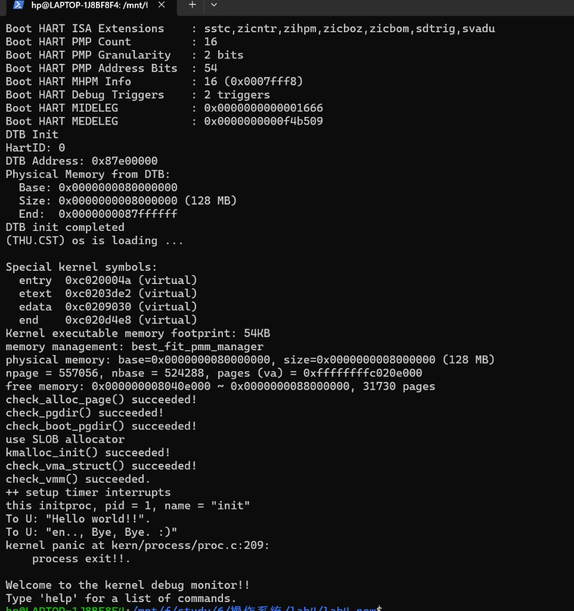
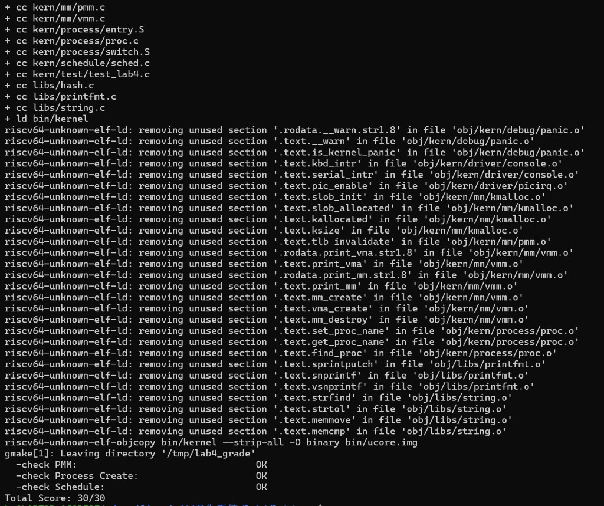

# 操作系统实验报告

## Lab4：进程管理（页表映射、内核线程与调度）

> 代码仓库参考：https://github.com/liujiawen2005/OSlab/tree/lab4/code
> 实验指导书：http://oslab.mobisys.top/lab2026/_book/lab4/lab4.html
> 报告格式：Markdown（`.md`），以文字说明为主
> 本地代码目录：`lab4/code`

---

## 实验基本信息

| 项目 | 内容 |
| ---- | ---- |
| **实验名称** | Lab4：进程管理 |
| **小组成员** | 2411820-刘家文，2414004-王乐，2413994-陈宇凡 |
| **完成日期** | 2026-11-21 |
| **代码路径** | https://github.com/liujiawen2005/OSlab/tree/lab4/code（Makefile、kern/、libs/、tools/） |
| **报告存放** | `lab4/report.md` |
| **评分结果** | `make grade` → Total Score 30/30（PMM、Process Create、Schedule 均为 OK） |

### 小组分工

| 成员 | 负责的练习 / 模块 |
| ---- | ----------------- |
| 2411820-刘家文 | 功能模块一：`page_insert` / `page_remove` / `page_remove_pte` |
| 2414004-王乐 | 功能模块二：`alloc_proc`、`proc_init`、`kernel_thread`、`do_fork`、`copy_thread`、`copy_mm` |
| 2413994-陈宇凡 | 功能模块三：`cpu_idle`、`schedule`、`proc_run`、`switch_to`，以及报告整理 |

指导书要求提交前把代码里的 `YOUR CODE` 换成对应学号。当前 `lab4` 分支里三处标记仍是 `//LAB4 function1/2/3 YOUR CODE`，函数体已经写好。提交前按上表替换注释即可，不必改逻辑。

---

## 一、实验目的

Lab2 解决了“哪些物理页可以分配”，Lab3 建立了中断入口。本实验要在这两者之上回答两件事：一块物理页怎样挂到指定线性地址上，以及内核怎样同时保有多个可切换的执行流。

本实验的主要目的是：

1. 在 Sv39 三级页表上完成映射的建立和撤销，使页表项、物理页引用计数和 TLB 保持一致；
2. 用进程控制块描述内核线程，创建 `idleproc` 和 `initproc`，并把新线程的第一次进入路径接到 `forkret → forkrets → kernel_thread_entry`；
3. 用 FIFO / 轮转调度和 `switch_to` 完成内核线程切换，让 `initproc` 真正跑起来；
4. 理解本实验的虚拟内存仍是预映射：地址空间在建立时一次写好页表，不做缺页按需分配，也不做页面置换。

内核线程在这里被当成一种特殊进程。它们只在内核态运行，共享启动页表 `boot_pgdir`，因此 `mm` 保持为空。用户进程要到后面的实验才拥有独立的用户地址空间。

---

## 二、实验环境

### 2.1 实验平台与工具链

与 Lab2 相同，目标仍是 QEMU `virt` 上的 RISC-V 64 内核：

| 项目 | 内容 |
| ---- | ---- |
| 目标架构 | RISC-V 64，Sv39 分页 |
| 交叉编译 | `riscv64-unknown-elf-gcc`，根目录 `Makefile` |
| 模拟器 | `qemu-system-riscv64 -machine virt` |
| 固件 | OpenSBI（`make grade` 使用 `-bios default`） |
| 启动链 | `kern_init` → `pmm_init` → `pic_init` / `idt_init` → `vmm_init` → `proc_init` → `cpu_idle` |

`tools/grade.sh` 在 `DEBUG_GRADE` 下编译，并通过 `tools/inject.py` 把测试插进现有函数：`test_lab4_pmm_basic()` 插在 `pmm_init` 末尾，`test_lab4_process_create()` 插在 `proc_init` 末尾，`test_lab4_schedule()` 插在 `init_main` 开头。三项检查各 10 分，满分 30。

### 2.2 AI 工具使用情况

| 成员 | AI 编程工具 | 底层模型 | 备注 |
| ---- | ----------- | -------- | ---- |
| 2411820-刘家文 | codex | gpt-6 | 页表映射 |
| 2414004-王乐 | Cursor | 豆包 | 线程创建 |
| 2413994-陈宇凡 | Cursor | Claude Opus 5.5 | 调度与报告 |

提示词按指导书要求的四段来写：要做什么、能依赖哪些现成接口、交付时必须满足的断言、不能破坏的不变量。下面各模块给出的是与当前源码对应的最终提示词。报告不编造未在终端里出现过的编译报错。

---

## 三、实验整体逻辑分析

### 3.1 本章节的逻辑主线

本章先把“线性地址 ↔ 物理页”补完整，再让 CPU 上出现第二个执行流。前半段没有可切换的线程，页表只为后面的地址空间服务；后半段没有正确的页表根，线程切换时也无法装入 `satp`。所以顺序是页操作，然后创建线程，最后才调度。

执行链是：

```text
kern_init
  → pmm_init          物理页分配器 + 启动页表自检
  → pic_init/idt_init 中断框架（Lab3）
  → vmm_init          mm_struct / vma_struct 自检
  → proc_init         登记 idleproc，fork 出 initproc
  → cpu_idle
       → schedule → proc_run → switch_to
            → forkret → forkrets → __trapret → kernel_thread_entry → init_main
```

`vmm.c` 已经提供 `mm_create`、`vma_create`、`insert_vma_struct`、`find_vma`。本实验的内核线程不使用它们：`copy_mm` 看到 `current->mm == NULL` 就直接返回 0。`do_pgfault` 的检查在 `vmm_init` 里被注释掉，缺页处理留到后续实验。

### 3.2 功能的逐步实现

1. **先做页映射。** `get_pte` 已经能沿着 PDX1、PDX0 找到或建出叶子页表项。`page_insert` / `page_remove` 只在这个槽位上改映射。没有这对函数，`check_pgdir` 和 Lab4 的 PMM 测试都无法通过，线程的页表根也没有维护手段。
2. **再做线程对象。** `alloc_proc` 给出空白 PCB，`kernel_thread` 把“函数 + 参数”装进一张临时 `trapframe`，`do_fork` 分配内核栈、PID 和链表结点，`copy_thread` 规定这个线程第一次被 `switch_to` 恢复时从 `forkret` 开始。`idleproc` 不走这条路，它就是当前启动现场。
3. **最后做调度。** `proc_init` 把 `idleproc->need_resched` 置 1。`cpu_idle` 一进来就会 `schedule`。调度器在 `proc_list` 上找到 `initproc`，`proc_run` 装入它的 `pgdir` 并 `switch_to`。新线程没有“从 `switch_to` 返回”的旧现场，只能靠事先写好的 `context.ra` 进入 `forkret`。

### 3.3 关键文件

| 路径 | 作用 |
| ---- | ---- |
| `kern/mm/pmm.c` | `get_pte`、`page_insert`、`page_remove`、`page_remove_pte` |
| `kern/mm/vmm.c` | 虚拟内存区域描述，本实验只做结构自检 |
| `kern/process/proc.c` | PCB 分配、fork、内核线程入口包装、`proc_run`、`cpu_idle` |
| `kern/process/proc.h` | `proc_struct`、`context`、四种进程状态 |
| `kern/process/entry.S` | `kernel_thread_entry`：用 `s1` 当参数调用 `s0` |
| `kern/process/switch.S` | 保存 / 恢复 `ra, sp, s0–s11` |
| `kern/schedule/sched.c` | 轮转选择下一个 `PROC_RUNNABLE` 线程 |
| `kern/trap/trapentry.S` | `forkrets` 把 `sp` 指到新线程的 trapframe，再走 `__trapret` |
| `tools/test_lab4.c` | 三项自动测试 |
| `libs/riscv.h` 的 `lsatp` | Sv32 遗留写法，本实验不能用它装 Sv39 的 `satp` |

---

## 四、实验内容与实现

### 功能模块一：虚拟内存页操作

**负责人：** 2411820-刘家文

#### 模块功能描述

**需要实现的函数：**

```c
int page_insert(pde_t *pgdir, struct Page *page, uintptr_t la, uint32_t perm);
void page_remove(pde_t *pgdir, uintptr_t la);
static void page_remove_pte(pde_t *pgdir, uintptr_t la, pte_t *ptep);
```

这个模块只改叶子映射。`get_pte(pgdir, la, 1)` 负责把中间两级页表页补齐；补不出来就返回 `NULL`，`page_insert` 返回 `-E_NO_MEM`，不留下半张已经挂到根页表上的目录。`get_pte` 在第二级分配失败时会把刚申请、尚未写入 `*pdep1` 的上一级页释放掉。

`page_insert` 要区分三种情况：

- 该线性地址还没有有效映射：新页 `ref` 加 1，再写入页表项；
- 已经映射到**另一**物理页：新页 `ref` 先加 1，再撤掉旧映射（旧页 `ref` 减到 0 就 `free_page`）；
- 已经映射到**同一**物理页：只改权限，`ref` 不变，也不把页释放再申请。

`page_remove` 是幂等的。中间页表不存在，或槽位存在但 `PTE_V` 为 0，都直接返回。测试会对同一地址连续 `page_remove` 两次。

Sv39 的叶子页表项不能只写调用者传来的 `perm`。规范要求叶子至少有 R 或 X，并且 W=1 时 R 也必须为 1。调用方经常传 `0` 或只传 `PTE_U | PTE_W`。实现里在写入前补上 `PTE_R`：

```c
if ((perm & (PTE_R | PTE_X)) == 0 || (perm & PTE_W)) {
    perm |= PTE_R;
}
*ptep = pte_create(page2ppn(page), perm);
tlb_invalidate(pgdir, la);
```

`pte_create` 自己会或上 `PTE_V`。中间级目录项仍由 `ptd_create` 生成，只有 `PTE_V`，不能带 R/W/X/U。`check_pgdir` 用这一点检查 `boot_pgdir_va[0]`。

引用计数和 TLB 必须跟页表项一起变。撤映射时先把槽位清 0，再 `sfence.vma` 指定地址，最后 `page_ref_dec`，减到 0 才归还物理页。同一页被两处线性地址映射时，拆掉一处只是 `ref` 从 2 变成 1，页还在空闲链表之外。

#### 最终提示词

````text
[PROMPT]
在 kern/mm/pmm.c 已有的 get_pte 之后实现 page_remove_pte、page_remove、page_insert。
page_insert 建立或更新 la 到 page 的叶子映射；get_pte(..., 1) 失败时返回 -E_NO_MEM。
同一物理页只改权限时不得改变 ref，也不得改变空闲页数量。
换成另一物理页时，新页 ref 先加再撤旧映射；旧页 ref 到 0 才 free_page。
page_remove 对未映射地址直接返回。每次修改当前正在使用的翻译后，用 tlb_invalidate(pgdir, la)。
Sv39 叶子必须带 R 或 X；只要 W=1 就必须带 R。perm 为 0 或仅有 PTE_W 时补上 PTE_R。
不要给上一级目录项加 PTE_U / PTE_R / PTE_W / PTE_X。

[RELY]
kern/mm/pmm.c 的 get_pte、check_pgdir；kern/mm/pmm.h 的 pte_create、pte2page、page_ref_inc/dec、tlb_invalidate。
tools/test_lab4.c 的 test_lab4_pmm_basic。
权限位：PTE_V、PTE_R、PTE_W、PTE_X、PTE_U。

[GUARANTEE]
check_pgdir() 打印 succeeded；测试输出 [Test PMM] PASS。
覆盖：首次插入 ref==1；替换后旧页 ref==0、新页 ref==2；同页改权限时 ref 与 nr_free_pages 不变；重复 page_remove 后三个页的 ref 都为 0。

[SPECIFICATION]
中间页表的分配失败由 get_pte 清理，page_insert 不要再释放同一页。
不要用 lsatp。不要改 boot 阶段的 1GB 恒等映射。
````

#### 与测试对齐的关键点

`check_pgdir` 和 `test_lab4_pmm_basic` 把上面的三种映射情况都走了一遍：

- `page_insert(..., p1, 0, 0)` 之后 `pte2page == p1` 且 `page_ref(p1) == 1`；
- 先把 `p2` 映射到 `PGSIZE` 并带 `PTE_U | PTE_W`，再把同一地址改成 `p1` 且权限为 0，于是 `page_ref(p1) == 2`、`page_ref(p2) == 0`，U/W 被清掉；
- 对 `p3` 在同一地址上把权限改成 `PTE_W`，`ref` 仍为 1，`nr_free_pages()` 不变；
- 删掉三处映射后再删一次 `2 * PGSIZE`，三个 `ref` 都是 0。

根页表项的检查是 `(boot_pgdir_va[0] & (PTE_V|PTE_U|PTE_R|PTE_W|PTE_X)) == PTE_V`。指导书里较旧的片段写过 `boot_pgdir[0] & PTE_U`，和当前 `check_pgdir` 相反。实现以当前源码里的断言为准：用户位只出现在叶子项上。

---

### 功能模块二：进程创建及初始化

**负责人：** 2414004-王乐

#### 模块功能描述

**需要实现的函数：**

```c
static struct proc_struct *alloc_proc(void);
static int copy_mm(uint32_t clone_flags, struct proc_struct *proc);
static void copy_thread(struct proc_struct *proc, uintptr_t esp, struct trapframe *tf);
int do_fork(uint32_t clone_flags, uintptr_t stack, struct trapframe *tf);
int kernel_thread(int (*fn)(void *), void *arg, uint32_t clone_flags);
void proc_init(void);
```

`alloc_proc` 用 `kmalloc` 拿到一块 PCB，`memset` 成 0，再把必须显式规定的字段设好：`state = PROC_UNINIT`，`pid = -1`，`pgdir = boot_pgdir_pa`，两条链表结点 `list_init`。其余指针因此是 `NULL`，`context` 全 0，`need_resched`、`runs`、`flags` 都是 0。分配失败返回 `NULL`。

`proc_init` 先初始化 `proc_list` 和 1024 个哈希桶。`idleproc` **不是** fork 出来的：它占用当前这条启动执行流，`pid = 0`，状态直接设为 `PROC_RUNNABLE`，`kstack` 指向 `entry.S` 里的 `bootstack`，`need_resched = 1`，名字是 `"idle"`。它不挂进 `proc_list`。`current` 指向它，`nr_process` 变为 1。

随后 `kernel_thread(init_main, "Hello world!!", 0)` 创建 1 号线程。`kernel_thread` 在栈上填一张临时 trapframe：

- `gp`、`tp` 从当前线程抄过来，保证新线程仍能找到全局数据和小线程指针；
- `s0 = fn`，`s1 = arg`，这两个被调用者保存寄存器会原样出现在新线程第一次 `sret` 之后；
- `status` 在当前 `sstatus` 上置 `SSTATUS_SPP | SSTATUS_SPIE`，并清掉 `SSTATUS_SIE`。`SPP` 让 `sret` 回到 S 态，`SPIE` 让返回后打开中断，构造 trapframe 期间则先关中断；
- `epc = kernel_thread_entry`；
- 调用 `do_fork(clone_flags | CLONE_VM, 0, &tf)`。本实验的内核线程都共享内核地址空间，所以强制带上 `CLONE_VM`。

`do_fork` 的资源顺序是：检查 `nr_process`，`alloc_proc`，`parent = current`，`setup_kstack`（`KSTACKPAGE = 2`，共 8KB），`copy_mm`，`copy_thread`，关中断后 `get_pid`、挂哈希表和 `proc_list`、`nr_process++`、`wakeup_proc`。任一步失败就按已分配的资源回退：有内核栈则 `put_kstack`，然后 `kfree` PCB。`wakeup_proc` 要求状态还不是 `PROC_RUNNABLE`，所以新线程在此之前必须停在 `PROC_UNINIT`。第一个可用 PID 是 1，因此 `initproc->pid == 1`。

`copy_mm` 在本实验是占位。当前线程没有 `mm` 时返回 0，有 `mm` 时返回 `-E_INVAL`。内核线程的 `proc->mm` 保持 `NULL`，页表根仍是 `alloc_proc` 写下的 `boot_pgdir_pa`。

`copy_thread` 把 trapframe 放在新内核栈的最高处，并规定第一次切换的上下文：

```c
proc->tf = (struct trapframe *)(stack_top - sizeof(*tf));
*proc->tf = *tf;
proc->tf->gpr.a0 = 0;
proc->tf->gpr.sp = (esp == 0) ? stack_top : esp;
proc->context.ra = (uintptr_t)forkret;
proc->context.sp = (uintptr_t)proc->tf;
```

`a0` 被清成 0，这是子进程从 fork 返回时的返回值约定。真正的线程参数在 `s1` 里，不在 `a0` 里。`kernel_thread_entry` 会执行 `move a0, s1` 再 `jalr s0`，所以 `init_main` 看到的参数仍是 `"Hello world!!"`。

`context.sp` 指向这块 trapframe，而不是 `stack_top`。`switch_to` 恢复后直接 `ret` 到 `forkret`。RISC-V 函数先减小 `sp` 再写栈，因此 `forkret` 自己的栈帧落在 trapframe 下方，调用 `forkrets` 之前不会先把这张表盖掉。`forkrets` 再把 `sp` 设成这张 trapframe，跳进 `__trapret`，按 `SAVE_ALL` 的布局恢复寄存器并 `sret` 到 `kernel_thread_entry`。

`sret` 之后的 `sp` 来自 `tf->gpr.sp`。`kernel_thread` 传入的 `esp` 是 0，所以这里写成 `stack_top`。trapframe 本身占着栈顶往下 `sizeof(trapframe)` 的位置，线程函数继续压栈时会复用这段内存。内核线程此后靠 `switch_to` 切换，不再沿这张启动 trapframe 返回，Lab4 的调度测试可以这样运行。函数若从 `kernel_thread_entry` 返回，接着就是 `jal do_exit`。本实验的 `do_exit` 直接 `panic("process exit!!.\n")`，进程回收留到后面。

#### 最终提示词

````text
[PROMPT]
在 kern/process/proc.c 完成 alloc_proc、copy_mm、copy_thread、do_fork、kernel_thread、proc_init。
alloc_proc 失败返回 NULL；成功时 PCB 为 UNINIT、pid=-1、pgdir=boot_pgdir_pa，context 和 mm、tf、parent 为空。
idleproc 复用当前现场：pid 0，RUNNABLE，kstack=bootstack，need_resched=1，名字 idle，不插入 proc_list。current 指向它。
kernel_thread 把 fn 放入 s0、arg 放入 s1，epc 指向 kernel_thread_entry，status 置 SPP 和 SPIE 并清除 SIE，再 do_fork(clone_flags|CLONE_VM, 0, &tf)。
do_fork 按 kstack → copy_mm → copy_thread → 关中断分配 pid → 挂链表 → wakeup_proc 的顺序做；失败路径释放已拿到的栈和 PCB。
copy_thread 把 trapframe 放在内核栈顶部，a0 置 0，context.ra=forkret，context.sp 指向该 trapframe。esp==0 时恢复后的 sp 用栈顶。
copy_mm 在 current->mm==NULL 时返回 0，否则返回 -E_INVAL。不要复制用户地址空间。

[RELY]
kern/process/proc.h、proc.c 中已有的 get_pid、hash_proc、setup_kstack、wakeup_proc、forkret。
kern/process/entry.S、kern/trap/trapentry.S 的 forkrets。
tools/test_lab4.c 的 test_lab4_process_create。它在 proc_init 返回前运行。

[GUARANTEE]
proc_init 结束后 idleproc 与 initproc 满足测试断言，initproc->pid==1，parent 是 idleproc，mm 为 NULL，context.ra 和 context.sp 非 0。
kernel_thread 返回正的 pid。

[SPECIFICATION]
不要把 idleproc 标成 ZOMBIE 或再次 wakeup。wakeup_proc 断言状态不是 RUNNABLE。
测试发生在第一次 schedule 之前，此时 idleproc->runs 仍为 0、context.ra 仍为 0。
````

#### 与测试对齐的关键点

`test_lab4_process_create` 在 `proc_init` 末尾运行，此时还没有发生切换。它检查的是创建结果，不是调度结果：`current == idleproc`，idle 的 pid、状态、栈、空的 `mm` / `tf` / `parent`、`runs == 0`、`flags == 0`、`context.ra == 0`；`initproc` 的 pid 为 1、状态可运行、父进程是 idle、`mm` 为空，并且 `context.ra`、`context.sp` 已经写好。这些字段若在 `alloc_proc` 里漏掉 `memset`，或把 idle 也走一遍 `copy_thread`，断言会直接失败。

---

### 功能模块三：进程调度

**负责人：** 2413994-陈宇凡

#### 模块功能描述

**需要实现的函数：**

```c
void cpu_idle(void);
void schedule(void);
void proc_run(struct proc_struct *proc);
void switch_to(struct context *from, struct context *to); /* switch.S */
```

`cpu_idle` 是 idle 线程的主体，不返回。循环里只看 `current->need_resched`，为真就调用 `schedule`。`proc_init` 已经把这个标志置上，所以进入 `cpu_idle` 后不必等时钟中断，就会把 CPU 让出去。指导书写明本实验的调度点就在这里；测试代码也会主动把 `need_resched` 置 1 再调用 `schedule`。

`schedule` 全程关中断。它先清掉 `current->need_resched`，再从进程链表里找下一个 `PROC_RUNNABLE`：

- `current` 是 idle 时，从 `proc_list` 表头开始，idle 自己不在链表上；
- 否则从当前线程的 `list_link` 的下一个开始，走到表尾再绕回，形成轮转；
- 扫完仍没有就绪线程，`next` 保持为 `idleproc`。

找到后 `next->runs++`。只有 `next != current` 才 `proc_run`。这样线程自己仍是唯一就绪者时，不会对自己做一次 `switch_to`。

`proc_run` 也关中断。目标就是 `current` 时什么都不做。否则先把 `current` 改成目标，再按 `enable_paging` 的方式写 `satp`：

```c
uintptr_t satp = ((uintptr_t)SATP_MODE_SV39 << 60) | (proc->pgdir >> RISCV_PGSHIFT);
write_csr(satp, satp);
flush_tlb();
switch_to(&prev->context, &proc->context);
```

`SATP_MODE_SV39` 是 8，左移 60 位后等于 `enable_paging` 里的 `0x8000000000000000`。`libs/riscv.h` 的 `lsatp` 写的是 `SATP32_MODE`（bit 31），那是 RV32/Sv32 的模式位，装不进 Sv39 根页表，本实验不能调用它。页表切换后整表 `sfence.vma`，再交换上下文。

`local_intr_restore` 写在 `switch_to` 之后。切走的线程要等别人再切回来，才会沿着 `proc_run` 的后半段恢复中断标志。新线程第一次并不从这里返回，它的中断开关由 trapframe 里的 `SPIE` 经 `sret` 完成。

`switch_to` 只保存被调用者保存寄存器，顺序与 `struct context` 一致：`ra, sp, s0` 到 `s11`，各 8 字节。`a0` 是旧 context，`a1` 是新 context。调用者保存寄存器由编译器在调用 `schedule` / `proc_run` 时处理。恢复 `ra` 之后的 `ret`，对老线程是回到 `proc_run`，对新线程是进入 `forkret`。

#### 最终提示词

````text
[PROMPT]
实现 cpu_idle、schedule、proc_run 和 switch.S 里的 switch_to。
cpu_idle 在 need_resched 为真时调用 schedule，自身不返回。
schedule 关中断，清除 need_resched。idle 从 proc_list 头开始找，其他线程从自己的下一个结点开始找，只选择 PROC_RUNNABLE；找不到就用 idleproc。选中者 runs 加 1，且仅在不是 current 时 proc_run。
proc_run 关中断，更新 current，用 Sv39 模式写 satp：模式 8 放在 bit 63:60，PPN 为 proc->pgdir >> 12，然后 flush_tlb 和 switch_to。不要调用 lsatp。
switch_to 按 proc.h 的 context 字段顺序保存并恢复 ra、sp、s0–s11，最后 ret。

[RELY]
kern/schedule/sched.c、kern/process/proc.c、kern/process/switch.S、kern/process/proc.h 的 struct context。
kern/mm/pmm.c 的 enable_paging。kern/sync/sync.h 的 local_intr_save/restore。
tools/test_lab4.c 的 test_lab4_schedule，以及 init_main 的三行输出。

[GUARANTEE]
两个测试线程都能运行，输出 [Test Schedule] PASS。
init_main 打印 pid=1、name="init"、To U: "Hello world!!"。以及 To U: "en.., Bye, Bye. :)"。

[SPECIFICATION]
schedule 与 proc_run 的临界区不能被时钟中断插进来改 current。
switch_to 不判断调度策略，也不改 satp。
新线程第一次运行依赖 copy_thread 已把 ra 设为 forkret。
````

#### 与测试对齐的关键点

`test_lab4_schedule` 插在 `init_main` 开头，此时 `current` 已经是 `initproc`。它再创建两个内核线程，两者都是 `PROC_RUNNABLE` 并挂在 `initproc` 后面。循环 8 次把 `need_resched` 置 1 并调用 `schedule`。每个测试线程内部同样主动调度。轮转会先后选中这两个线程，把 `test_thread1_ran` 和 `test_thread2_ran` 写成 1。断言要求两个标志都为真。

测试返回后 `init_main` 继续打印三行字符串。`grade.sh` 同时匹配 `[Test Schedule] PASS` 和这三行。`init_main` 返回后会进入 `do_exit` 的 panic；评分脚本只检查这些字符串是否出现，不要求内核停在 `cpu_idle`。

---

### 扩展练习 Challenge

**负责人：** 2413994-陈宇凡

#### 1. `local_intr_save` / `local_intr_restore` 怎样开关中断

定义在 `kern/sync/sync.h`，真正改的是 `sstatus.SIE`：

```c
static inline bool __intr_save(void) {
    if (read_csr(sstatus) & SSTATUS_SIE) {
        intr_disable();
        return 1;
    }
    return 0;
}
static inline void __intr_restore(bool flag) {
    if (flag) {
        intr_enable();
    }
}
```

`intr_disable` 是 `clear_csr(sstatus, SSTATUS_SIE)`，`intr_enable` 是 `set_csr(sstatus, SSTATUS_SIE)`。S 态是否响应中断由 `SIE` 决定。

`local_intr_save(intr_flag)` 把**调用前**的开关状态记进 `intr_flag`：原来开着就关掉并记下 1，原来关着就保持关闭并记下 0。`local_intr_restore(intr_flag)` 只有在记下的值是 1 时才重新打开。因此内层临界区的 restore 不会把外层已经关掉的中断打开。`do_fork` 分配 PID、`schedule` 选择线程、`proc_run` 改 `current` 和 `satp` 都用这组宏包起来。

这和 `kernel_thread` 里写进 trapframe 的 `SIE` / `SPIE` 不是同一层。前者保护的是“现在这段内核代码”，后者规定的是“新线程 `sret` 之后”要不要开中断。

#### 2. `get_pte` 里两段相似代码，以及 Sv32 / Sv39 / Sv48

`get_pte` 先处理 `PDX1`（VPN[2]，虚地址 bit 38:30），再处理 `PDX0`（VPN[1]，bit 29:21），最后返回 `PTX`（VPN[0]）对应的叶子槽。两段代码都在做同一件事：

1. 该项无效：若 `create` 为假，或 `alloc_page` 失败，则返回 `NULL`（上一级若是本次新分配的，还要还回去）；
2. 该项有效且带 R/W/X：这是大页叶子，不能再往下走，返回 `NULL`；
3. 该项有效且不带 R/W/X：这是指向下一级页表的目录项，用 `PDE_ADDR` 转到下一级。

它们相像，是因为 RISC-V 每一级非叶子页表的表项格式相同：低 10 位是标志，`PTE_V` 表示存在，R/W/X 全 0 表示“指向下一级”，否则表示“这一级已经是叶子”。页表页都是 4KB、512 项，所以每一级的分配、清零、建目录项可以写成同样的形状。

级别数量不同，所以不能把 Sv32 和 Sv48 都套进现在这两段：

| 模式 | 虚拟地址划分 | 页表级数 | 相对现在的 `get_pte` |
| ---- | ------------ | -------- | -------------------- |
| Sv32 | 10 + 10 + 12 | 2 | 只有一级目录，不需要 PDX1 那段 |
| Sv39 | 9 + 9 + 9 + 12 | 3 | 正好是现在的 PDX1、PDX0、PTX |
| Sv48 | 9 + 9 + 9 + 9 + 12 | 4 | 还要再往上走一级 |

Sv32 的 VPN 字段是 10 位而不是 9 位，`satp` 也是 32 位布局。这就是 `lsatp` 不能拿来做 Sv39 的原因。

两段代码并不完全一样。第一段先记住新分配的上一级页，成功走到第二级之后才写 `*pdep1`。这样第二级 `alloc_page` 失败时，根页表上还没有指向这张半成品目录的项。第二段一旦分到叶子页表就立刻写 `*pdep0`，因为它下面不再分配别的页表页。

#### 3. 查找和分配要不要拆开

合在 `get_pte(pgdir, la, create)` 里，调用点很短：插入传 1，删除和查询传 0。Lab4 只有这一对调用方式，合并是合适的。

代价是一个函数同时承担“只读查找”和“可能分配内存的修改”。`create == 0` 时仍然可能返回一个存在但 `PTE_V` 为 0 的槽位指针，调用者必须再看有效位。分配失败、遇到大页、中间页要回滚，也都堆在同一个函数里，Sv48 若再复制一段，三份清理逻辑容易不一致。

若后面实验开始在缺页路径上频繁查找，更干净的拆法是：`walk_pte` 只查找，不分配；`map_page` 在需要时逐级分配并处理失败回滚。本实验保持 `get_pte` 的现有接口即可，`page_insert` 和 `page_remove` 已经把“建映射”和“删映射”分开了。

---

## 五、测试与验证

自动评分看的是串口输出里的固定字符串，不是 GDB 断点。`tools/grade.sh` 的三项为：

| 检查 | 分值 | 必须出现的输出 |
| ---- | ---- | -------------- |
| check PMM | 10 | `[Test PMM] PASS` |
| check Process Create | 10 | `[Test Process Create] PASS` |
| check Schedule | 10 | `[Test Schedule] PASS`，以及 `this initproc, pid = 1, name = "init"`、`To U: "Hello world!!".`、`To U: "en.., Bye, Bye. :)"` |

实测 `make grade` 三项都是 OK，总分为 **30/30**。

### 5.1 `make qemu` 启动日志

普通启动不插入 `tools/test_lab4.c`，所以串口里没有 `[Test ...] PASS`。内核完成物理内存、页表和 VMA 自检后切到 `initproc`，打印三行问候，随后 `init_main` 返回并进入 `do_exit`。当前 `do_exit` 直接 panic，panic 之后落入内核调试监视器。这是本实验预期的结束方式，不是页表或调度失败。

日志中的关键行：

```text
check_alloc_page() succeeded!
check_pgdir() succeeded!
check_boot_pgdir() succeeded!
check_vmm() succeeded.
this initproc, pid = 1, name = "init"
To U: "Hello world!!".
To U: "en.., Bye, Bye. :)"
kernel panic at kern/process/proc.c:209:
    process exit!!.
```



### 5.2 `make grade` 自动评分

`make grade` 会在临时目录注入三项测试后再跑 QEMU。PMM、Process Create、Schedule 均为 OK。



---

## 六、知识点对照与未覆盖原理

### 6.1 实验知识点与 OS 原理

| 实验中的知识点 | 对应 OS 原理 | 含义、关系和差异 |
| -------------- | ------------ | ---------------- |
| `page_insert` / `page_remove` | 页表与地址变换 | 软件负责填写 PTE，硬件按 `satp` 指向的根页表做翻译。实验里映射在插入时一次建好 |
| 引用计数 | 页框共享与回收 | 同一物理页可以挂到多个线性地址。`ref` 到 0 才回收。它不表示这个页“正在被某个线程运行” |
| `sfence.vma` | TLB 一致性 | 改软件页表不会自动改掉已经缓存的翻译。实验只做了全表或单地址的刷新，没有 ASID 细分 |
| `proc_struct` | 进程控制块 | PCB 把状态、标识、地址空间、内核栈和切换现场放在一起。本实验还没有打开文件表和用户地址空间 |
| `context` 与 `trapframe` | 上下文切换 / 陷入现场 | `context` 只存被调用者保存寄存器，供 `switch_to` 使用。`trapframe` 按 `SAVE_ALL` 保存陷入时的整组寄存器，供 `sret` 使用。新线程第一次执行要先伪造一张 trapframe |
| `schedule` + `need_resched` | 调度点与轮转 | 调度点在 idle 循环和测试主动让出 CPU 时。链表上的“下一个就绪线程”就是本实验的策略，没有优先级和时间片记账 |
| `local_intr_save` | 临界区 | 用关中断保证改 `current`、链表和 `satp` 时不被时钟打断。这还不是锁，多核下不够 |
| `boot_pgdir` 共享 | 内核线程与用户进程 | 这些线程属于同一个内核地址空间。用户进程才会有自己的 `mm` 和用户页表 |
| Sv39 三级页表 | 多级页表 | 用目录项把没使用的地址范围留成空表，避免一张巨大的线性页表。实验的中间级在 `get_pte` 里按需分配 |

### 6.2 本实验没有覆盖的重要原理

1. 缺页异常和按需调页。`do_pgfault` 的检查被注释掉，本实验要求页面预先映射。
2. 页面置换、工作集和抖动。`mm_struct.sm_priv` 只是留给后面实验的字段。
3. 用户进程、`fork` 之后的用户地址空间复制，以及系统调用返回值以外的完整 `fork`/`exec`/`wait`。
4. 进程退出和父进程回收。`do_exit` 现在直接 panic，没有僵尸进程回收。
5. 抢占式时间片。时钟中断已经能打开，但调度点仍由 `need_resched` 和显式 `schedule` 触发，调度器不计算时间片。
6. 多核调度、运行队列和真正的睡眠队列。现在只有一条 `proc_list`，`PROC_SLEEPING` 没有被本实验的代码置位。
7. 写时复制、共享内存和按段设置的细粒度内核映射。启动映射仍是大页，`.text` 与 `.data` 的权限还没有拆开。指导书指出了这个安全问题，本实验的练习不要求重做这段映射。

---

## 七、实验总结与收获

### 7.1 对操作系统的理解

本实验把“内存映射”和“执行流”接在了一起。页表回答一个线性地址现在落在哪一页，PCB 回答这段执行流下次恢复时寄存器和页表根是什么。只有映射，内核仍然只有 `kern_init` 一条控制流；只有 PCB 而没有 `switch_to`，线程对象也跑不起来。

`idleproc` 和 `initproc` 的创建方式不同，这个差别后面会一直保留：0 号线程是启动时已经在跑的那条流，1 号线程才是被构造出 trapframe、靠调度器第一次调度进去的线程。用户进程的创建会沿用后者，而不是再伪造一个“当前已经在运行”的现场。

另一条主线是两套现场不能混用。线程之间的自愿切换只保存 `s0–s11` 和 `ra/sp`；从中断或第一次启动返回时，必须有一张和 `trapentry.S` 布局一致的 trapframe。`copy_thread` 把 `context.ra` 设成 `forkret`，就是为了把“调度器眼里的切换”接上“异常返回眼里的启动”。

### 7.2 AI 协作开发的经验

页表和线程代码里，接口的不变量比函数名字更重要。提示词需要写明：同页改权限时引用计数不变、W 位必须带 R、`wakeup_proc` 不能看到已经是 `PROC_RUNNABLE` 的线程、`satp` 必须用 Sv39 的 64 位模式而不是 `lsatp`。这些约束都来自当前仓库的 `check_pgdir`、`test_lab4.c` 和 `enable_paging`，而不是通用操作系统教材里的某一份伪代码。

指导书里个别旧片段和当前断言不一致，例如根页表项是否带 `PTE_U`。生成或修改代码时应以 `kern/` 里实际的 `assert` 和 `tools/grade.sh` 匹配的字符串为准。

---
